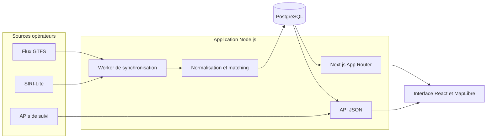

# BusMinute

[](https://github.com/DownvoteEDw/BusMinute/actions/workflows/ci.yml)


Application web full-stack de recherche et de suivi des bus longue distance en Europe. BusMinute agrège les horaires et les données temps réel d’Alsa, BlaBlaCar Bus et FlixBus afin de présenter des départs, des retards et des positions de véhicules dans une interface unique.

Ce projet personnel couvre l’ensemble du cycle d’un produit web : intégration de sources externes hétérogènes, modélisation métier, persistance PostgreSQL, API, rendu React, cartographie, SEO, tests et déploiement Docker.

## Aperçu

- recherche par numéro de service, ville, gare ou liaison ;
- suivi détaillé d’un trajet avec horaires prévus, estimés et constatés ;
- carte MapLibre avec arrêts et dernière position GPS disponible ;
- tableaux de départs actualisés automatiquement ;
- historique de ponctualité par ligne et destination ;
- interface responsive en français, anglais et espagnol ;
- pages permanentes et URL partageables pour les services et les circulations ;
- signalements voyageurs persistés et protégés contre les abus.

## Enjeux techniques traités

### Unifier des données de transport hétérogènes

Les connecteurs isolent les spécificités de chaque opérateur. Le cœur métier rapproche horaires GTFS, mises à jour SIRI-Lite et réponses temps réel à partir du numéro de service, de la date locale, de la séquence des arrêts et des écarts horaires. Le résultat reste explicable et testable, y compris pour les horaires après minuit et les fuseaux propres aux agences.

### Servir des pages rapides sans dépendre des opérateurs

Un worker synchronise les horaires et le flux SIRI-Lite vers PostgreSQL. Le rendu serveur lit uniquement les instantanés persistés et ne contacte jamais directement un opérateur. Les sections lentes sont isolées avec React Suspense et le streaming Next.js, tandis que le navigateur actualise ensuite les données par API. Les enrichissements FlixBus et Alsa passent par des clients bornés en concurrence et en durée.

### Présenter le temps réel sans fausse précision

La carte et la frise distinguent une position récente, une dernière position connue, une estimation approximative et une position indisponible. Les retards déjà constatés sont conservés et les projections ne modifient que les étapes actuelles ou futures.

### Concevoir pour la production

Les entrées publiques sont bornées, les appels concurrents utilisent des files limitées et les connecteurs disposent de délais maximaux et de replis. Les migrations, contrôles de santé, URL canoniques, sitemaps et archives font partie du même produit, pas d’un prototype séparé.

## Architecture



Le site, le worker et les migrations partagent le même code et la même image Docker. Cette architecture monolithique modulaire réduit le coût opérationnel tout en séparant clairement fournisseurs, logique métier, persistance et présentation.

## Stack

| Couche | Technologies |
| --- | --- |
| Frontend | React 19, Next.js 16 App Router, TypeScript, CSS, MapLibre GL |
| Backend | Node.js 22, Route Handlers Next.js, worker asynchrone |
| Données | PostgreSQL, GTFS, SIRI-Lite, migrations SQL |
| Qualité | Vitest, TypeScript strict, tests d’intégration, tests HTTP et streaming |
| Livraison | Docker, Docker Compose, GitHub Actions, Coolify |

## Qualité et validation

La commande `npm run check` compile le cœur en TypeScript strict, exécute les tests puis produit le build Next.js de production. La CI complète cette validation avec :

- des scénarios de rendu quand un fournisseur externe ralentit ou échoue ;
- des contrôles HTTP sur les statuts, métadonnées, redirections et archives ;
- le démarrage de la stack PostgreSQL complète avec Docker Compose ;
- un smoke test de recherche sur un trajet GTFS/SIRI conservé en fixture.

## Démarrage rapide

Prérequis : Node.js 22 ou ultérieur.

```powershell
npm install
$env:GTFS_PATH = "tests/fixtures/gtfs-50819"
$env:SIRI_PATH = "tests/fixtures/siri-50819-2026-08-22.json"
npm run dev
```

Ouvrir [http://localhost:3000](http://localhost:3000), puis rechercher `50819`.

Ce mode utilise les fixtures versionnées et ne nécessite pas PostgreSQL. En production, les pages lisent les données synchronisées par le worker dans la base et ne téléchargent aucun flux opérateur pendant leur rendu.

## Docker Compose

La stack de production contient le site BusMinute, son worker de synchronisation, une migration ponctuelle et PostgreSQL. Les migrations sont appliquées automatiquement avant le démarrage du site et du worker.

```powershell
Copy-Item .env.example .env
docker compose -f docker-compose.yaml -f compose.local.yaml up --build -d
```

Remplacer impérativement `POSTGRES_PASSWORD` dans `.env` avant le premier démarrage, puis ouvrir [http://localhost:3000](http://localhost:3000).

```powershell
docker compose -f docker-compose.yaml -f compose.local.yaml ps
docker compose -f docker-compose.yaml -f compose.local.yaml logs app
docker compose -f docker-compose.yaml -f compose.local.yaml logs worker
```

Arrêter la stack sans supprimer les données :

```powershell
docker compose -f docker-compose.yaml -f compose.local.yaml down
```

Le volume `busminute-postgres` conserve PostgreSQL entre les déploiements.

## Déploiement GitHub et Coolify

1. Créer un dépôt GitHub privé avec les fichiers du projet.
2. Dans Coolify, créer une application depuis ce dépôt et choisir le build pack Docker Compose.
3. Sélectionner `docker-compose.yaml` comme fichier de déploiement.
4. Définir `SITE_URL` avec le domaine HTTPS public et générer un `POSTGRES_PASSWORD` long.
5. Associer le domaine au service `app` sur le port `3000`.
6. Déployer puis vérifier `/api/health`.

Coolify utilise uniquement `docker-compose.yaml`. Le fichier `compose.local.yaml` sert au développement et ne doit pas être ajouté au déploiement Coolify.

Variables disponibles :

| Variable | Obligatoire | Rôle |
| --- | --- | --- |
| `SITE_URL` | oui | origine HTTPS publique utilisée par les métadonnées |
| `MAP_STYLE_URL` | non | style MapLibre public fourni au navigateur au démarrage du serveur ; CARTO Voyager par défaut |
| `POSTGRES_PASSWORD` | oui | secret PostgreSQL |
| `POSTGRES_DB` | non | base, `busminute` par défaut |
| `POSTGRES_USER` | non | utilisateur, `busminute` par défaut |
| `DATABASE_SSL` | non | `false` avec le PostgreSQL interne |
| `GTFS_URL` | non | source GTFS officielle |
| `FLIXBUS_GTFS_ENABLED` | non | active FlixBus, `true` par défaut |
| `FLIXBUS_GTFS_URL` | non | source GTFS officielle FlixBus |
| `FLIXBUS_GTFS_TIMEOUT_MS` | non | délai de téléchargement du GTFS FlixBus, `300000` par défaut |
| `FLIXBUS_REALTIME_ENABLED` | non | active le suivi FlixBus, `true` par défaut |
| `FLIXBUS_REALTIME_API_URL` | non | adresse du service de suivi FlixBus |
| `FLIXBUS_TRACKER_URL` | non | page utilisée pour retrouver la configuration publique du suivi |
| `FLIXBUS_REALTIME_API_KEY` | non | clé facultative, sinon retrouvée automatiquement |
| `FLIXBUS_REALTIME_TIMEOUT_MS` | non | délai maximal d’une requête FlixBus, `12000` par défaut |
| `FLIXBUS_REALTIME_BUDGET_MS` | non | durée maximale totale du suivi FlixBus, découverte de configuration comprise, `5000` par défaut |
| `FLIXBUS_REALTIME_CACHE_SECONDS` | non | durée du cache en mémoire, `30` secondes par défaut |
| `FLIXBUS_REALTIME_CONCURRENCY` | non | nombre maximal de recherches de suivi FlixBus simultanées, `4` par défaut |
| `FLIXBUS_REALTIME_QUEUE_LIMIT` | non | nombre maximal de recherches FlixBus en attente, `100` par défaut |
| `ALSA_ENABLED` | non | active les horaires Alsa, `true` dans Docker Compose |
| `ALSA_LOCATIONS_URL` | non | catalogue public des gares Alsa |
| `ALSA_CONNECTIONS_URL` | non | horaires publics de réservation Alsa |
| `ALSA_TIMEOUT_MS` | non | délai maximal d’une requête Alsa, `30000` par défaut |
| `ALSA_LOCATION_LIMIT` | non | nombre maximal de lieux principaux découverts, `500` par défaut |
| `ALSA_SERVICE_DAYS` | non | nombre de jours d’horaires Alsa synchronisés, `3` par défaut |
| `ALSA_CONCURRENCY` | non | nombre maximal de requêtes Alsa simultanées, `4` par défaut |
| `ALSA_ORIGIN_BATCH_SIZE` | non | nombre de gares de départ par requête Alsa, `10` par défaut |
| `ALSA_DESTINATION_BATCH_SIZE` | non | nombre de gares d’arrivée par requête Alsa, `70` par défaut |
| `ALSA_DESTINATION_COUNTRIES` | non | filtre facultatif de pays, séparés par des virgules |
| `ALSA_REALTIME_ENABLED` | non | active le suivi Alsa, `true` par défaut |
| `ALSA_REALTIME_TRACKER_URL` | non | page publique utilisée pour ouvrir une session de suivi Alsa |
| `ALSA_REALTIME_BUDGET_MS` | non | durée maximale totale d’une recherche de suivi Alsa, `5000` par défaut |
| `ALSA_REALTIME_TIMEOUT_MS` | non | délai maximal d’une requête de suivi Alsa, `15000` par défaut |
| `ALSA_REALTIME_CACHE_SECONDS` | non | durée du cache des retards Alsa, `30` secondes par défaut |
| `ALSA_REALTIME_LOCATION_CACHE_SECONDS` | non | durée du cache du catalogue de villes Alsa, `21600` secondes par défaut |
| `ALSA_REALTIME_SESSION_SECONDS` | non | durée de réutilisation d’une session du localisateur Alsa, `600` secondes par défaut |
| `ALSA_REALTIME_CONCURRENCY` | non | nombre maximal de recherches de suivi Alsa simultanées, `2` par défaut |
| `ALSA_REALTIME_QUEUE_LIMIT` | non | nombre maximal de recherches Alsa en attente, `100` par défaut |
| `ALSA_REALTIME_BEFORE_DEPARTURE_MINUTES` | non | ouverture de la fenêtre de suivi avant le départ, `120` minutes par défaut |
| `ALSA_REALTIME_AFTER_ARRIVAL_MINUTES` | non | fermeture de la fenêtre de suivi après l’arrivée, `360` minutes par défaut |
| `SIRI_URL` | non | source SIRI-Lite officielle |
| `REALTIME_SYNC_INTERVAL_SECONDS` | non | fréquence SIRI, `60` par défaut |
| `GTFS_SYNC_INTERVAL_HOURS` | non | fréquence GTFS, `24` par défaut |
| `HISTORY_RETENTION_DAYS` | non | conservation des observations, `90` jours par défaut |
| `IMAGE_TAG` | non | étiquette locale de l’image Docker |

PostgreSQL n’est pas publié sur Internet. Seul le service `app` est exposé au proxy Coolify. Le contrôle `/api/health` vérifie la connexion à la base, le dernier cycle GTFS/SIRI et la fraîcheur de la donnée temps réel.

## Synchronisation et historique

Le worker applique le cycle suivant :

```text
Horaires BlaBlaCar Bus + FlixBus + Alsa quotidiens
      ↓
horaires PostgreSQL
      ↓
SIRI-Lite chaque minute
      ↓
matching GTFS ↔ SIRI
      ↓
état courant + observations historiques
      ↓
pages et API BusMinute
```

`trip_stop_realtime` contient le dernier état connu de chaque arrêt. `trip_stop_observations` conserve les états successifs sans doublonner une même observation source. Les anciennes circulations restent accessibles par leur référence, même après leur disparition du flux officiel.

Lancer un seul cycle de synchronisation dans Docker :

```powershell
docker compose run --rm -e SYNC_ONCE=true worker
```

Lancer le worker directement avec un PostgreSQL configuré :

```powershell
npm run build:core
$env:SYNC_ONCE='true'
npm run worker
```

## Import PostgreSQL

Importer manuellement un GTFS complet dans une stack en fonctionnement :

```powershell
docker compose run --rm --volume C:/data:/data migration node dist/src/cli/import-gtfs.js /data/blablacar-gtfs.zip
```

## Pages et API

### Carte du trajet

Les commandes `npm run dev` et `npm run build` copient automatiquement le worker MapLibre et son module partagé dans les ressources publiques. Ces fichiers générés sont également inclus dans l’image Docker.

La carte conserve la présentation du suivi et utilise MapLibre, chargé seulement lorsque la carte ouverte approche de l’écran. Le fond routier par défaut est CARTO Voyager, avec les attributions du fournisseur. `MAP_STYLE_URL` permet de choisir un autre style compatible ou d’ajouter une clé publique de carte propre au site ; cette URL est transmise au navigateur et ne doit pas contenir de secret serveur. La variable est disponible à l’exécution dans Docker Compose, sans reconstruction pour changer sa valeur.

Les arrêts proviennent des coordonnées GTFS. Le connecteur Alsa expose les coordonnées des véhicules effectivement reçues ; le flux ne fournit pas d’horodatage de mesure GPS, aussi `vehiclePositions[].receivedAt` indique la réception de la réponse, et l’interface affiche « Reçue… ». Les coordonnées absentes, non finies, hors limites et `0,0` sont rejetées. Les plaques d’immatriculation ne sont pas exposées par l’API du trajet.

Le connecteur FlixBus exploite `location.coordinates` et conserve `location.updated_at` dans `vehiclePositions[].recordedAt`, indépendamment de l’heure de réception. Son horodatage GPS sert au vieillissement du repère, même si les horaires viennent d’être actualisés. Le cache du connecteur ne renouvelle pas ces horodatages.

Une position datant de plus de deux minutes, ou conservée après une réponse sans position, est présentée comme dernière position connue. Elle disparaît de la carte après trente minutes. Les trajets terminés et annulés n’affichent aucun véhicule. Sans coordonnées de véhicule, la carte affiche seulement les arrêts ; elle ne déduit jamais une position à partir des horaires. Le flux EstimatedTimetable BlaBlaCar Bus ne fournit pas de coordonnées de véhicule au connecteur : sa carte affiche les arrêts.

La carte se replie, propose la vue de tous les arrêts et le recentrage sur les véhicules, et laisse les horaires disponibles si le fond de carte ou WebGL échoue. Aucune migration de base de données n’est nécessaire : les champs `location` des arrêts et `vehiclePositions` des trajets sont facultatifs pour rester compatibles avec les anciennes publications.

### Adresses

| Adresse | Rôle |
| --- | --- |
| `/` | accueil et recherche |
| `/recherche?q=50819` | résultats de recherche |
| `/suivi/50819%3A2026-08-22` | suivi détaillé d’une circulation |
| `/villes` | annuaire des villes et gares |
| `/ville/paris` | gares et bus d’une ville |
| `/departs/paris/2026-08-22` | départs d’une ville à une date donnée |
| `/gares/XPB` | prochains passages à un arrêt |
| `/trajets/XPB/XTO` | circulations entre deux arrêts |
| `/api/search?q=50819` | recherche JSON |
| `/api/journeys/50819%3A2026-08-22` | circulation JSON |
| `/api/reports` | lecture et création des signalements |
| `/api/health` | état du service et de PostgreSQL |

## URL publiques et migration SEO

Les services de bus ont une page permanente `/bus/blablacar-bus/50819`. Une circulation utilise une adresse telle que `/suivi/blablacar-bus/50819/2026-08-22-86066eb7204abf42e320`. Le suffixe distingue les départs ayant le même numéro et la même date. Les anciennes URL `/suivi/<référence>` restent accessibles par redirection HTTP 308 vers leur circulation exacte.

Les liens internes, les URL canoniques et le sitemap des circulations utilisent les nouvelles adresses. Le sous-sitemap `/sitemaps/services.xml` référence les pages permanentes. Les nouvelles liaisons `/trajets/paris/tours` regroupent les gares et opérateurs disponibles ; les pages historiques entre deux gares conservent leurs adresses et leur contenu spécifique.

La migration `003_journey_publications` doit être appliquée avant de démarrer cette version. Le service `migration` de Docker Compose l’applique automatiquement. Hors Compose :

```powershell
npm run db:migrate
npm run db:backfill-links
```

La seconde commande sauvegarde les anciennes circulations encore présentes dans `trip_instances`. Elle peut être relancée et doit être exécutée avant une purge de l’historique. Avec l’image Docker construite pour cette version, après la migration :

```sh
docker compose run --rm app node dist/src/cli/backfill-journey-links.js
```

Les circulations publiées par les listes, les sitemaps et les pages de suivi sont ensuite enregistrées automatiquement dans `journey_publications`, avec leur correspondance et leurs derniers horaires sauvegardés. Cette table est indépendante de la purge des observations temps réel : la conserver dans les sauvegardes PostgreSQL et ne pas la purger avec l’historique. Les données déjà supprimées avant cette migration ne peuvent pas être reconstituées ; une URL inconnue reste une 404, sans redirection vers un autre départ.

Les pages permanentes restent indexables lorsqu’aucun prochain départ n’est annoncé. La règle existante `noindex` des circulations, 48 heures après leur fin, est conservée ; ces archives sont exclues du sitemap des circulations. Les archives affichent leur date, un lien vers les prochains départs et ferment les signalements. Une migration d’URL peut produire des fluctuations temporaires dans Google : conserver les redirections durablement et surveiller les erreurs et les clics dans Search Console après déploiement.

Sans PostgreSQL, le développement utilise des snapshots JSON dans un répertoire `busminute-links-*` du dossier temporaire système. Ce stockage local n’est pas destiné à assurer la conservation des URL en production.

## Validation

```powershell
npm run check
```

Cette commande compile le cœur TypeScript en mode strict, exécute les tests puis produit le build Next.js de production.

Après le build, vérifier le rendu pendant une réponse opérateur bloquée :

```powershell
npm run test:streaming
```

Ce test lance un serveur Next.js de production et bloque une API FlixBus locale, avec un budget volontairement porté à 60 secondes. Il vérifie que les pages d’accueil, recherche, villes, départs, gare, liaison, service et suivi terminent leur HTML et leurs métadonnées pendant que l’API temps réel attend encore. Il vérifie également les vrais statuts HTTP 404/308, les URL canonical, les données structurées et l’indexation des archives avec les agents utilisateur navigateur, Googlebot et Twitterbot. Les publications et serveurs de test sont isolés puis supprimés à la fin. Ce test est exécuté en CI après le build.

Le rendu utilise `transitPageDataService`, qui interdit les requêtes aux opérateurs. Les sections de données sont isolées par Suspense et des frontières d’erreur : la navigation et la recherche restent accessibles pendant le chargement. Les API utilisent les mêmes snapshots et caches GTFS, puis ajoutent le temps réel. Après l’affichage, les panneaux et listes actualisent leurs données par API ; les lots sont limités à 20 trajets et les requêtes sont annulées au démontage. Une réponse lente ne maintient donc pas la page ouverte dans l’attente d’un opérateur. Les lectures locales restent asynchrones et les données structurées SEO sont conservées dans le rendu serveur.

Sur les URL dynamiques, la vérification d’existence et de redirection précède le streaming pour conserver les statuts HTTP 404/308. Elle consulte le catalogue enregistré ou la publication du trajet, sans charger les listes de départs ni contacter un opérateur. Les données des sections se chargent ensuite sous Suspense. Si les métadonnées sont indisponibles, la page garde une canonical et reçoit `noindex, follow`, sans hériter silencieusement de l’indexation par défaut du site.

Une circulation dont le temps réel peut encore répondre reste en suivi jusqu’à la confirmation de son arrivée, avec une limite de six heures après la dernière heure d’arrivée connue. Elle n’est donc pas archivée à l’heure théorique lorsqu’un retard est encore possible. La fenêtre SEO de 48 heures après la fin effective du trajet reste inchangée.

Le second scénario de `test:streaming` rend le stockage des publications inaccessible : il vérifie la canonical et le `noindex` des sections en erreur, ainsi que le statut 500 lorsqu’une panne empêche de vérifier l’existence d’une URL. Une panne ne doit pas être traitée comme une ressource inexistante (404).

Rejouer uniquement le matching réel :

```powershell
npm run match -- tests\fixtures\gtfs-50819 tests\fixtures\siri-50819-2026-08-22.json 50819:2026-08-22
```

Résultat attendu :

```json
{
  "status": "matched",
  "journeyRef": "50819:2026-08-22",
  "serviceNumber": "50819",
  "serviceDate": "2026-08-22",
  "tripId": "7672428505",
  "method": "SERVICE_NUMBER_DATE_STOP_SEQUENCE_TIMES",
  "stops": [
    "XPB",
    "XOS",
    "XTO"
  ]
}
```

## Matching

| Signal | Poids |
| --- | ---: |
| Numéro de service identique | 35 % |
| Service actif à la date SIRI | 20 % |
| Séquence d’arrêts | 30 % |
| Écart entre horaires GTFS et horaires SIRI visés | 15 % |

Les horaires GTFS sont interprétés dans `agency_timezone` et les valeurs supérieures à `24:00:00` sont acceptées. Un score insuffisant produit `unmatched`. Deux meilleurs candidats trop proches produisent `ambiguous`.

## Structure

```text
app/                 pages et API Next.js
components/          composants interactifs
Dockerfile           image autonome de production
docker-compose.yaml  stack Coolify et production
compose.local.yaml   ports réservés au développement local
src/application/     services destinés au front
src/cli/             migration, import et worker de synchronisation
src/providers/       importeur GTFS et parser SIRI
src/services/        matcher GTFS ↔ SIRI
src/db/              persistance PostgreSQL
migrations/          schéma PostgreSQL
tests/               tests et extrait réel 50819
public/              ressources publiques
.github/workflows/   validation GitHub automatique
```
