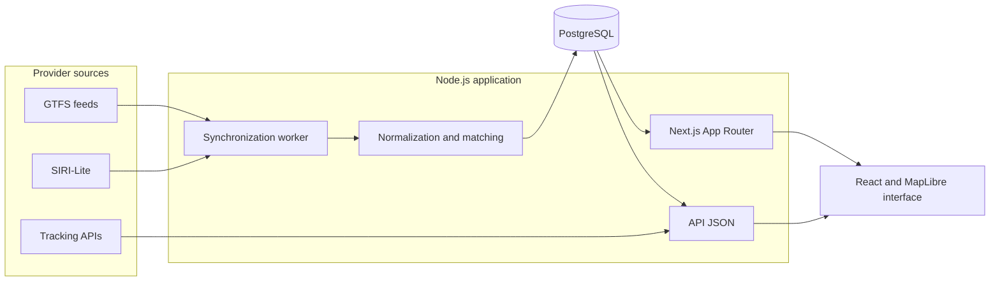

# BusMinute

[](https://github.com/DownvoteEDw/BusMinute/actions/workflows/ci.yml)


Full-stack web application for searching and tracking long-distance buses across Europe. BusMinute aggregates schedules and realtime data from Alsa, BlaBlaCar Bus and FlixBus to display departures, delays and vehicle positions in a single interface.

This personal project covers the entire web product lifecycle: heterogeneous third-party integrations, domain modelling, PostgreSQL persistence, APIs, React rendering, mapping, SEO, testing and Docker deployment.

## Overview

- search by service number, city, station or route;
- detailed journey tracking with scheduled, estimated and actual times;
- MapLibre map with stops and the latest available GPS position;
- automatically refreshed departure boards;
- punctuality history by service and destination;
- responsive interface available in French, English and Spanish;
- permanent pages and shareable URLs for services and journeys;
- persistent passenger reports with abuse protection.

## Engineering highlights

### Unifying heterogeneous transport data

Provider adapters isolate each operator's specific behaviour. The domain layer reconciles GTFS schedules, SIRI-Lite updates and realtime responses using the service number, local service date, stop sequence and timetable offsets. Matching remains explainable and testable, including after-midnight schedules and agency-specific time zones.

### Serving fast pages without coupling rendering to providers

A worker synchronizes schedules and the SIRI-Lite feed into PostgreSQL. Server rendering reads persisted snapshots only and never contacts a provider directly. Slow sections are isolated with React Suspense and Next.js streaming, while the browser subsequently refreshes data through the API. FlixBus and Alsa enrichments use clients with bounded concurrency and time budgets.

### Showing realtime data without implying false precision

The map and timeline distinguish a recent position, a last-known position, an approximate estimate and unavailable location data. Observed delays are preserved, while projections affect current and future stops only.

### Designing for production

Public inputs are bounded, concurrent calls use limited queues, and provider clients enforce timeouts and fallbacks. Database migrations, health checks, canonical URLs, sitemaps and archives are part of the application itself rather than a separate prototype.

## Architecture



The website, worker and migrations share the same codebase and Docker image. This modular monolith keeps operational overhead low while maintaining clear boundaries between providers, domain logic, persistence and presentation.

## Stack

| Layer | Technologies |
| --- | --- |
| Frontend | React 19, Next.js 16 App Router, TypeScript, CSS, MapLibre GL |
| Backend | Node.js 22, Next.js Route Handlers, asynchronous worker |
| Data | PostgreSQL, GTFS, SIRI-Lite, SQL migrations |
| Quality | Vitest, strict TypeScript, integration, HTTP and streaming tests |
| Delivery | Docker, Docker Compose, GitHub Actions, Coolify |

## Quality and validation

`npm run check` compiles the core in strict TypeScript mode, runs the test suite and produces a production Next.js build. CI extends this validation with:

- rendering scenarios for slow or unavailable external providers;
- HTTP checks covering statuses, metadata, redirects and archived journeys;
- a complete PostgreSQL stack started with Docker Compose;
- a search smoke test based on a versioned GTFS/SIRI journey fixture.

## Quick start

Requirement: Node.js 22 or later.

```powershell
npm install
$env:GTFS_PATH = "tests/fixtures/gtfs-50819"
$env:SIRI_PATH = "tests/fixtures/siri-50819-2026-08-22.json"
npm run dev
```

Open [http://localhost:3000](http://localhost:3000), then search for `50819`.

This mode uses versioned fixtures and does not require PostgreSQL. In production, pages read data synchronized by the worker from the database and never download provider feeds while rendering.

## Docker Compose

The production stack contains the BusMinute website, its synchronization worker, a one-off migration service and PostgreSQL. Migrations run automatically before the website and worker start.

```powershell
Copy-Item .env.example .env
docker compose -f docker-compose.yaml -f compose.local.yaml up --build -d
```

Replace `POSTGRES_PASSWORD` in `.env` before the first start, then open [http://localhost:3000](http://localhost:3000).

```powershell
docker compose -f docker-compose.yaml -f compose.local.yaml ps
docker compose -f docker-compose.yaml -f compose.local.yaml logs app
docker compose -f docker-compose.yaml -f compose.local.yaml logs worker
```

Stop the stack without deleting data:

```powershell
docker compose -f docker-compose.yaml -f compose.local.yaml down
```

The `busminute-postgres` volume preserves PostgreSQL data between deployments.

## GitHub and Coolify deployment

1. Create a GitHub repository containing the project files.
2. In Coolify, create an application from the repository and select the Docker Compose build pack.
3. Select `docker-compose.yaml` as the deployment file.
4. Set `SITE_URL` to the public HTTPS origin and generate a strong `POSTGRES_PASSWORD`.
5. Attach the domain to the `app` service on port `3000`.
6. Deploy, then verify `/api/health`.

Coolify uses `docker-compose.yaml` only. `compose.local.yaml` is intended for local development and must not be added to the Coolify deployment.

Available variables:

| Variable | Required | Purpose |
| --- | --- | --- |
| `SITE_URL` | yes | public HTTPS origin used in metadata |
| `MAP_STYLE_URL` | no | public MapLibre style sent to the browser at server startup; defaults to CARTO Voyager |
| `POSTGRES_PASSWORD` | yes | PostgreSQL secret |
| `POSTGRES_DB` | no | database name; defaults to `busminute` |
| `POSTGRES_USER` | no | database user; defaults to `busminute` |
| `DATABASE_SSL` | no | use `false` with the internal PostgreSQL service |
| `GTFS_URL` | no | official GTFS source |
| `FLIXBUS_GTFS_ENABLED` | no | enables FlixBus; defaults to `true` |
| `FLIXBUS_GTFS_URL` | no | official FlixBus GTFS source |
| `FLIXBUS_GTFS_TIMEOUT_MS` | no | FlixBus GTFS download timeout; defaults to `300000` |
| `FLIXBUS_REALTIME_ENABLED` | no | enables FlixBus tracking; defaults to `true` |
| `FLIXBUS_REALTIME_API_URL` | no | FlixBus tracking service URL |
| `FLIXBUS_TRACKER_URL` | no | page used to discover the public tracking configuration |
| `FLIXBUS_REALTIME_API_KEY` | no | optional key; discovered automatically when omitted |
| `FLIXBUS_REALTIME_TIMEOUT_MS` | no | per-request FlixBus timeout; defaults to `12000` |
| `FLIXBUS_REALTIME_BUDGET_MS` | no | total FlixBus tracking budget including configuration discovery; defaults to `5000` |
| `FLIXBUS_REALTIME_CACHE_SECONDS` | no | in-memory cache duration; defaults to `30` seconds |
| `FLIXBUS_REALTIME_CONCURRENCY` | no | maximum concurrent FlixBus tracking lookups; defaults to `4` |
| `FLIXBUS_REALTIME_QUEUE_LIMIT` | no | maximum queued FlixBus tracking lookups; defaults to `100` |
| `ALSA_ENABLED` | no | enables Alsa schedules; `true` in Docker Compose |
| `ALSA_LOCATIONS_URL` | no | public Alsa station catalogue |
| `ALSA_CONNECTIONS_URL` | no | public Alsa booking schedules |
| `ALSA_TIMEOUT_MS` | no | Alsa request timeout; defaults to `30000` |
| `ALSA_LOCATION_LIMIT` | no | maximum number of discovered primary locations; defaults to `500` |
| `ALSA_SERVICE_DAYS` | no | number of synchronized Alsa schedule days; defaults to `3` |
| `ALSA_CONCURRENCY` | no | maximum concurrent Alsa requests; defaults to `4` |
| `ALSA_ORIGIN_BATCH_SIZE` | no | departure stations per Alsa request; defaults to `10` |
| `ALSA_DESTINATION_BATCH_SIZE` | no | arrival stations per Alsa request; defaults to `70` |
| `ALSA_DESTINATION_COUNTRIES` | no | optional comma-separated country filter |
| `ALSA_REALTIME_ENABLED` | no | enables Alsa tracking; defaults to `true` |
| `ALSA_REALTIME_TRACKER_URL` | no | public page used to start an Alsa tracking session |
| `ALSA_REALTIME_BUDGET_MS` | no | total Alsa tracking budget; defaults to `5000` |
| `ALSA_REALTIME_TIMEOUT_MS` | no | Alsa tracking request timeout; defaults to `15000` |
| `ALSA_REALTIME_CACHE_SECONDS` | no | Alsa delay cache duration; defaults to `30` seconds |
| `ALSA_REALTIME_LOCATION_CACHE_SECONDS` | no | Alsa city catalogue cache duration; defaults to `21600` seconds |
| `ALSA_REALTIME_SESSION_SECONDS` | no | Alsa tracker session reuse duration; defaults to `600` seconds |
| `ALSA_REALTIME_CONCURRENCY` | no | maximum concurrent Alsa tracking lookups; defaults to `2` |
| `ALSA_REALTIME_QUEUE_LIMIT` | no | maximum queued Alsa tracking lookups; defaults to `100` |
| `ALSA_REALTIME_BEFORE_DEPARTURE_MINUTES` | no | tracking window before departure; defaults to `120` minutes |
| `ALSA_REALTIME_AFTER_ARRIVAL_MINUTES` | no | tracking window after arrival; defaults to `360` minutes |
| `SIRI_URL` | no | official SIRI-Lite source |
| `REALTIME_SYNC_INTERVAL_SECONDS` | no | SIRI synchronization interval; defaults to `60` seconds |
| `GTFS_SYNC_INTERVAL_HOURS` | no | GTFS synchronization interval; defaults to `24` hours |
| `HISTORY_RETENTION_DAYS` | no | observation retention period; defaults to `90` days |
| `IMAGE_TAG` | no | local Docker image tag |

PostgreSQL is not exposed to the Internet. Only the `app` service is exposed through the Coolify proxy. `/api/health` checks the database connection, the latest GTFS/SIRI cycle and realtime data freshness.

## Synchronization and history

The worker runs the following cycle:

```text
BlaBlaCar Bus + FlixBus + Alsa schedules daily
      ↓
PostgreSQL schedules
      ↓
SIRI-Lite every minute
      ↓
GTFS ↔ SIRI matching
      ↓
current state + historical observations
      ↓
BusMinute pages and APIs
```

`trip_stop_realtime` contains the latest known state for each stop. `trip_stop_observations` retains successive states without duplicating the same source observation. Past journeys remain accessible by reference after they disappear from the official feed.

Run a single synchronization cycle in Docker:

```powershell
docker compose run --rm -e SYNC_ONCE=true worker
```

Run the worker directly with a configured PostgreSQL instance:

```powershell
npm run build:core
$env:SYNC_ONCE='true'
npm run worker
```

## PostgreSQL import

Manually import a complete GTFS feed into a running stack:

```powershell
docker compose run --rm --volume C:/data:/data migration node dist/src/cli/import-gtfs.js /data/blablacar-gtfs.zip
```

## Pages and APIs

### Journey map

`npm run dev` and `npm run build` automatically copy the MapLibre worker and its shared module into the public assets. These generated files are also included in the Docker image.

The tracking layout uses MapLibre, which loads only when the expanded map approaches the viewport. CARTO Voyager is the default road map, with provider attribution. `MAP_STYLE_URL` can select another compatible style or add a site-specific public map key; this URL is sent to the browser and must not contain a server secret. The variable is available at Docker Compose runtime and can be changed without rebuilding the image.

Stops use GTFS coordinates. The Alsa adapter exposes vehicle coordinates only when they are actually received. Because the source does not provide a GPS measurement timestamp, `vehiclePositions[].receivedAt` records the response reception time and the interface labels it accordingly. Missing, non-finite, out-of-range and `0,0` coordinates are rejected. Registration plates are never exposed by the journey API.

The FlixBus adapter reads `location.coordinates` and preserves `location.updated_at` in `vehiclePositions[].recordedAt`, independently of the response time. This GPS timestamp determines marker freshness even when timetable data was refreshed more recently. Adapter caching never renews source timestamps.

A position older than two minutes, or retained after a response without coordinates, is presented as the last-known position. It disappears from the map after thirty minutes. Completed and cancelled journeys display no vehicle. Without vehicle coordinates, the map displays stops only and never infers a position from the timetable. The BlaBlaCar Bus `EstimatedTimetable` feed does not provide vehicle coordinates, so its map displays stops only.

The map can be collapsed, fit all stops and recenter on vehicles. Timetables remain available if the base map or WebGL fails. No database migration is required: stop `location` and journey `vehiclePositions` fields are optional to remain compatible with older publications.

### Routes

| Path | Purpose |
| --- | --- |
| `/` | home page and search |
| `/recherche?q=50819` | search results |
| `/suivi/50819%3A2026-08-22` | detailed journey tracking |
| `/villes` | city and station directory |
| `/ville/paris` | stations and buses in a city |
| `/departs/paris/2026-08-22` | city departures on a given date |
| `/gares/XPB` | upcoming calls at a stop |
| `/trajets/XPB/XTO` | journeys between two stops |
| `/api/search?q=50819` | JSON search endpoint |
| `/api/journeys/50819%3A2026-08-22` | JSON journey endpoint |
| `/api/reports` | passenger report reads and writes |
| `/api/health` | application and PostgreSQL health |

## Public URLs and SEO migration

Bus services have permanent pages such as `/bus/blablacar-bus/50819`. A journey uses a URL such as `/suivi/blablacar-bus/50819/2026-08-22-86066eb7204abf42e320`. The suffix distinguishes departures sharing the same service number and date. Legacy `/suivi/<reference>` URLs remain available through HTTP 308 redirects to the exact journey.

Internal links, canonical URLs and the journey sitemap use the new paths. `/sitemaps/services.xml` lists permanent service pages. New routes such as `/trajets/paris/tours` group available stations and operators, while historical station-to-station pages retain their existing paths and specific content.

Migration `003_journey_publications` must run before starting this version. The Docker Compose `migration` service applies it automatically. Outside Compose:

```powershell
npm run db:migrate
npm run db:backfill-links
```

The second command publishes historical journeys still present in `trip_instances`. It is safe to rerun and must execute before history is purged. With the Docker image built for this version, run it after the migration:

```sh
docker compose run --rm app node dist/src/cli/backfill-journey-links.js
```

Journeys exposed by lists, sitemaps and tracking pages are then saved automatically in `journey_publications`, together with their mapping and latest timetable snapshot. This table is independent from realtime observation retention: keep it in PostgreSQL backups and never purge it with history. Data removed before this migration cannot be reconstructed; an unknown URL remains a 404 and never redirects to another departure.

Permanent pages remain indexable when no upcoming departure is available. Journeys receive `noindex` 48 hours after completion and are removed from the journey sitemap. Archives display their date, link to upcoming departures and disable passenger reports. URL migrations can temporarily affect Google visibility, so redirects must remain in place and Search Console should be monitored after deployment.

Without PostgreSQL, development uses JSON snapshots in a `busminute-links-*` system temporary directory. This local storage is not intended to preserve production URLs.

## Validation

```powershell
npm run check
```

This command compiles the core in strict TypeScript mode, runs the tests and produces a production Next.js build.

After the build, verify rendering while a provider response is blocked:

```powershell
npm run test:streaming
```

This test starts a production Next.js server and blocks a local FlixBus API with an intentionally extended 60-second budget. It verifies that home, search, city, departure, station, route, service and tracking pages finish their HTML and metadata while the realtime API is still pending. It also checks actual HTTP 404/308 statuses, canonical URLs, structured data and archive indexing with browser, Googlebot and Twitterbot user agents. Test publications and servers are isolated and removed afterwards. CI runs this test after the build.

Rendering uses `transitPageDataService`, which forbids provider requests. Data sections are isolated with Suspense and error boundaries so navigation and search remain available during loading. APIs use the same snapshots and GTFS caches before adding realtime data. Once rendered, panels and lists refresh through APIs; batches are capped at 20 journeys and requests are aborted on unmount. A slow response therefore never keeps server rendering open while waiting for a provider. Local reads remain asynchronous and SEO structured data stays in the server-rendered output.

For dynamic URLs, existence and redirect checks run before streaming to preserve HTTP 404/308 statuses. They query the persisted catalogue or journey publication without loading departure lists or contacting a provider. Section data then loads under Suspense. If metadata is unavailable, the page retains a canonical URL and receives `noindex, follow` instead of silently inheriting the site's default indexing policy.

A journey whose realtime source can still respond remains active until arrival is confirmed, with a six-hour limit after the latest known arrival time. It is therefore not archived at its scheduled time while a delay remains possible. The 48-hour SEO window starts after the journey actually ends.

The second `test:streaming` scenario makes publication storage unavailable. It verifies canonical URLs and `noindex` on failed sections, as well as a 500 status when an outage prevents URL existence checks. An outage must never be treated as a missing resource (404).

Replay the real-world matching fixture only:

```powershell
npm run match -- tests\fixtures\gtfs-50819 tests\fixtures\siri-50819-2026-08-22.json 50819:2026-08-22
```

Expected result:

```json
{
  "status": "matched",
  "journeyRef": "50819:2026-08-22",
  "serviceNumber": "50819",
  "serviceDate": "2026-08-22",
  "tripId": "7672428505",
  "method": "SERVICE_NUMBER_DATE_STOP_SEQUENCE_TIMES",
  "stops": [
    "XPB",
    "XOS",
    "XTO"
  ]
}
```

## Matching

| Signal | Weight |
| --- | ---: |
| Identical service number | 35% |
| Service active on the SIRI date | 20% |
| Stop sequence | 30% |
| Offset between GTFS and target SIRI times | 15% |

GTFS times are interpreted using `agency_timezone`, and values beyond `24:00:00` are supported. An insufficient score produces `unmatched`; two leading candidates with scores that are too close produce `ambiguous`.

## Structure

```text
app/                 Next.js pages and APIs
components/          interactive components
Dockerfile           standalone production image
docker-compose.yaml  production and Coolify stack
compose.local.yaml   local development ports
src/application/     application services used by the frontend
src/cli/             migrations, imports and synchronization worker
src/providers/       GTFS importers and realtime adapters
src/services/        GTFS ↔ SIRI matcher
src/db/              PostgreSQL persistence
migrations/          PostgreSQL schema
tests/               tests and real-world 50819 fixture
public/              public assets
.github/workflows/   automated GitHub validation
```
